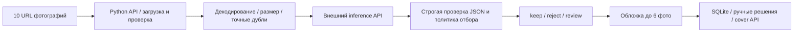

# Photo Separator — серверный отбор фотографий для ресторанных обложек

**Предпочтительный режим: модели работают на сторонних облачных серверах. Скачивать веса, устанавливать Ollama или иметь GPU на своём компьютере не требуется.** На устройстве запускается только небольшой Python-стенд: он принимает URL, загружает и нормализует фотографии, отправляет их выбранному inference-провайдеру и показывает результат.

Проект исследует задачу Restaurant Guru: заменить случайную фотографию на карточке ресторана сохранённой подборкой из **3–6 пригодных кадров**, поддержать ручное закрепление/исключение и поле `cover` в серверном API.

Если хороших кадров меньше трёх, сервис возвращает меньше трёх. Он не добирает обложку плохими фотографиями ради количества.

> Это самостоятельный исследовательский серверный прототип. Android/iOS и действующий production API Restaurant Guru не изменялись. Наличие адаптера провайдера не означает измеренную точность его модели. Реально проверены локальные Qwen3-VL 2B/8B и облачные GPT-6 Luna / DeepSeek Flash на одинаковых 20 фото. Выполнены реальные запросы ко всем восьми бесплатным OpenRouter endpoints; объём успешных оценок и ограничения приведены ниже.

Проверка источников и снимок облачного каталога: **29.10.2026**. Тарифы, квоты и доступность моделей могут изменяться.

## Измеренный рейтинг на 29.10.2026

Ниже модели от лучшей к худшей **по чистоте автоматически выбранных обложек**, затем по полноте, совпадению решений и nDCG. Это рейтинг конкретного стенда с неизменным промптом `restaurant-cover-v1`, а не универсальный рейтинг моделей. Допуск: все 20 фото, ноль технических ошибок, хотя бы одно принятие, полнота ≥50%. Покрытие ресторанов показано отдельно: хороший процент при нехватке обложек не решает задачу продукта.

<!-- leaderboard:start -->
| Место | Модель / размещение | Чистота обложек | Найдено хороших | Совпадение решений | Ошибочно приняты | ≥3 фото / рестораны | Расход за 20 фото |
|---|---|---|---|---|---|---|---|
| 1 | `qwen3-vl:2b-instruct` — локально, исторический тест | 87.5% | 87.5% | 80.0% | 1 | 2/2 | $0 API; оборудование отдельно |
| 2 | `gpt-6-luna` — платное облако | 83.3% | 62.5% | 80.0% | 1 | 1/2 | ≈$0.005070 |
| 3 | `qwen3-vl:8b-instruct` — локально, исторический тест | 80.0% | 100.0% | 90.0% | 2 | 2/2 | $0 API; оборудование отдельно |

**Вне рейтинга: ошибки или недостаточная полнота отбора:**
- `deepseek-flash`: 4 ошибок на 20 фото; приняты 3 фото, чистота 100%, полнота 37.5%; ≥3 фото в 0/2 ресторанах; расход ≥$0.007339 (неполный).
- `nvidia/nemotron-3-nano-omni-30b-a3b-reasoning:free`: 7 ошибок на 20 фото; приняты 6 фото, чистота 100%, полнота 75.0%; ≥3 фото в 2/2 ресторанах; расход $0 (free API).
- `dots-studio/dots-3-note-preview:free`: 3 ошибок на 20 фото; приняты 6 фото, чистота 100%, полнота 75.0%; ≥3 фото в 1/2 ресторанах; расход $0 (free API).
<!-- leaderboard:end -->

**Среди прогонов, допущенных к рейтингу:** Qwen 2B лидирует по чистоте, Qwen 8B — по полноте и общему совпадению решений (90%). GPT завершил прогон без ошибок, но недобрал обложки в одном ресторане. DeepSeek дал 4 ответа, не прошедших строгую проверку JSON/схемы; это проблема надёжности данного адаптера/промпта, а не доказательство слабого зрения модели. Неудачные ответы отправлены на ручную проверку. Порог и парсер после получения результатов не подгонялись.

Разметка предварительная, составлена агентом: 8 keep / 8 reject / 4 review, всего два ресторана. Локальные ответы пересчитаны на исправленной разметке v2 без повторного inference. Размер выборки и широкие интервалы не позволяют уверенно объявить победителя для production; ни одна модель не подтверждает безопасную автоматическую публикацию. Конфиденс модели не равен измеренной вероятности ошибки.

Стоимость — оценка по возвращённым токенам и настроенным тарифам, не счёт провайдера. У DeepSeek токены четырёх невалидных ответов не сохранены адаптером, поэтому сумма — нижняя граница. Общий учтённый расход двух облачных прогонов **не менее $0,0124088**. Скорость локальных и облачных запусков напрямую не сравнивается. [Сырые результаты и метрики](docs/benchmarks), [детали облачного теста](docs/CLOUD_PILOT.ru.md).

## Максимальный бесплатный облачный прогон

Проверен публичный каталог OpenRouter: **8 image-моделей с нулевой ценой**, включая четыре без принудительного JSON-режима. Для них добавлен режим JSON через промпт со строгой проверкой ответа. Выполнены реальные запросы ко **всем 8/8 endpoints**; полные отчёты по 20 фото получены для **2/8**. Остальные результаты частичные либо endpoint недоступен. Это не восемь завершённых сравнений качества. Ключи OpenAI и DeepSeek подходят только своим сервисам; их тесты выше являются платными. Неизмеренные модели не ранжируются по качеству.

| Бесплатная модель OpenRouter | Формат | Реальный результат |
|---|---|---|
| `dots-studio/dots-3-note-preview:free` | JSON object | Полный набор 20 фото; валидны 17/20; ошибки 3 |
| `google/gemma-4-26b-a4b-it:free` | JSON object | Provider HTTP 429; check model access, quota and key |
| `google/gemma-4-31b-it:free` | JSON object | Provider HTTP 429; check model access, quota and key |
| `nvidia/nemotron-3-nano-omni-30b-a3b-reasoning:free` | JSON через промпт | Полный набор 20 фото; валидны 13/20; ошибки 7 |
| `nvidia/nemotron-3.5-content-safety:free` | JSON через промпт | Model returned invalid assessment JSON; manual review required |
| `nvidia/nemotron-3.5-super-vl:free` | JSON object | Частичный тест: валидны 10/13 |
| `thinkingmachines/inkling-small:free` | JSON через промпт | Provider HTTP 403; check model access, quota and key |
| `thinkingmachines/inkling:free` | JSON через промпт | Provider HTTP 403; check model access, quota and key |

Бесплатные модели с полным набором — в порядке меньшего числа сбоев:

| Место | Модель | Чистота обложек | Полнота | Accuracy | Сбои / 20 | ≥3 фото / рестораны | Стоимость |
|---|---|---|---|---|---|---|---|
| 1 | Dots 3 Note Preview | 100% (6/6) | 75% | 80% | 3 | 1/2 | $0 |
| 2 | Nemotron Nano Omni Reasoning | 100% (6/6) | 75% | 55% | 7 | 2/2 | $0 |

**Среди двух бесплатных моделей, прошедших весь набор, Dots стабильнее:** 6/6 пригодных принятий, 75% полноты, 80% accuracy и 3 сбоя; Nano — те же 6/6 и 75%, но 55% accuracy и 7 сбоев. Оба результата исключены из основного рейтинга по заранее заданному правилу «ноль технических ошибок». Nano набрала ≥3 обложки в обоих ресторанах, Dots — в одном. На шести принятиях нижняя граница Wilson 95% около 61%: до доказанной production-надёжности далеко.

Финальный счётчик OpenRouter: **48/50 бесплатных запросов, $0 расхода, резерв 2**. Super VL проверена на 13/20 фото; продолжение требует восстановления квоты. Все процессы с ключом завершены, ключ в проект не записывался. [Подробный бесплатный отчёт](docs/FREE_RESULTS.ru.md), [сырые данные](docs/benchmarks/free-cloud).

Content Safety — специализированный кандидат; его пригодность для полной шкалы красоты/релевантности ещё нужно проверить. Preview/reasoning-модели могут не уложиться в лимит ответа или вернуть другую схему; это фиксируется как эксплуатационная ошибка, а не нулевая точность зрения.

Скрипт получает **весь актуальный** бесплатный image-каталог, проверяет нулевые цены prompt/completion/image/request, не использует платный fallback и сохраняет checkpoint после каждого ответа:

```bash
# Каталог без ключа и без inference:
uv run python scripts/benchmark_free.py --plan-only
# OPENROUTER_API_KEY передать через окружение процесса (не в командной строке).
# Если используется .env, его читает uv, а не shell:
uv run --env-file .env python scripts/benchmark_free.py --max-calls 40
# Повторить ту же команду после восстановления квоты: успешные фото не оплачиваются повторно.
```

На полном пилоте 8×20 = до 160 inference-вызовов. Скрипт сначала получает остаток квоты из `/api/v1/key`, затем ограничивает бюджет меньшим из `--max-calls` и `remaining−2`. Если числовой остаток недоступен, максимум 40; при ошибке metadata HTTP inference не начинается. Бюджет включает все отправленные попытки, даже если провайдер не засчитал отказ в дневную квоту. Другие приложения могут параллельно тратить квоту.

Сначала всем моделям даётся одно одинаковое фото, затем доступные модели проходят полный набор в порядке каталога. Проба на одном фото проверяет контракт API, а не качество модели. Интервал между отправками не меньше 3,2 секунды. Каждый model call имеет общий таймаут 150 секунд. HTTP 401/402 останавливает запуск; HTTP 403/429 сохраняется как недоступность конкретного endpoint, который пропускается. Это не попытка обойти ограничение провайдера. Следующий явный запуск переиспользует успешные ответы, зафиксированные ошибки и завершённые прогоны; для повторения ошибок есть `--retry-errors` (для нового формального сравнения используйте отдельную папку); для повторной проверки endpoint с сохранённым 403/429 нужен `--retry-unavailable`. Модели, не вернувшие валидную оценку на пробе, не расходуют ещё 20 вызовов на полный тест.

Скрипт не ждёт сутки и не планирует повторы. При изменении состава каталога результаты остаются на диске; текущий план отражает актуальный каталог. Не используйте два процесса с одной выходной папкой.

Файлы находятся в `results/free-cloud/`: план, checkpoint, ответы по ресторанам и метрики. Незавершённые результаты не попадают в рейтинг. После полного прогона выполните `uv run python scripts/publish_free_results.py` и `uv run python scripts/update_leaderboard.py` (либо `--free-dir results/другая-папка`): скрипт добавляет подходящие free-метрики к таблице README и обновляет `docs/benchmarks/leaderboard.json`. Задержка возобновлённых запусков непригодна для сравнения скорости. Исходный снимок восьми кандидатов: [free-cloud-plan-2026-10-29.json](docs/free-cloud-plan-2026-10-29.json). Gemini free tier дополнительно требует собственного ключа и доступной бесплатной квоты; HF даёт стартовые кредиты, а не безусловно бесплатный inference. Их доступ не проверен.

## Содержание

1. [Краткая рекомендация](#краткая-рекомендация)
2. [Что уже реализовано](#что-уже-реализовано)
3. [Архитектура и размещение моделей](#архитектура-и-размещение-моделей)
4. [Облачные варианты: бесплатные, с кредитами и платные](#облачные-варианты)
5. [Запуск без локальных моделей](#запуск-без-локальных-моделей)
6. [Как получить и передать ключ](#как-передать-api-ключ)
7. [Работа в интерфейсе](#работа-в-интерфейсе)
8. [Обновление бесплатных моделей](#обновление-бесплатных-моделей)
9. [Переключение на платного провайдера](#переключение-на-платного-провайдера)
10. [URL, форматы и обработка ошибок](#входные-фотографии)
11. [Правила отбора и оценки](#правила-отбора)
12. [Обложки, ручные действия и сохранение](#сохранение-и-ручные-действия)
13. [API и примеры запросов](#api)
14. [Стоимость и квоты](#стоимость-и-квоты)
15. [Что показал реальный pilot](#реальные-результаты-pilot)
16. [Бенчмарк и собственная разметка](#воспроизводимое-сравнение)
17. [Результаты, база и восстановление](#данные-и-восстановление)
18. [Переменные окружения](#переменные-окружения)
19. [Стенд на другом сервере](#размещение-самого-стенда-на-сервере)
20. [Свой удалённый GPU-сервер](#свой-удалённый-inference-сервер)
21. [Необязательный локальный inference](#дополнительный-локальный-режим)
22. [Структура проекта](#структура-проекта)
23. [Проверки и диагностика](#проверки)
24. [Что требуется для production](#границы-и-production)
25. [Источники и дополнительные документы](#документы-и-источники)

## Краткая рекомендация

Для первого облачного эксперимента:

1. **OpenRouter + бесплатная vision-модель**: в стенде есть Dots 3 Note Preview, Gemma 4, Nemotron Nano и Super VL. На этом пилоте Dots дала 6 пригодных обложек из 6 выбранных, но 3 сбоя на 20 фото; это кандидат для дальнейших испытаний с ручной проверкой. Веса хранятся у внешнего inference-провайдера. Нужны свой OpenRouter API-ключ и свободная квота.
2. Альтернатива — **Gemini Flash-Lite с бесплатной квотой** своего проекта.
3. Для продолжения сравнения на платном API — **DeepSeek Flash, GPT-6 Luna, Gemini Flash-Lite, Claude Haiku**; более дорогой контроль сложных кадров — **GPT-6.1 Terra/Sol или Claude Sonnet**.
4. Для открытых весов через другой управляемый облачный сервис — **Hugging Face Inference Providers**. Стартовые кредиты небольшие; это не безлимитный бесплатный сервер.

Это порядок экспериментов. Качество облачных кандидатов на ресторанных фотографиях пока **не измерено**. Выбор модели для автоматической публикации нужно делать после одинакового теста на подтверждённой редакторами выборке.

Под «открытым сервером» здесь понимается публично доступный официальный API моделей, включая открытые веса. Постоянный анонимный бесплатный GPU-сервис без ключа и ограничений не предполагается. Регистрация и ключ нужны даже для большинства бесплатных API. Создавать собственный GPU-сервер для начала не нужно.

## Что уже реализовано

- Приём **1–30 уникальных URL**; обычный сценарий — 10 фото одного ресторана.
- Проверенная загрузка и декодирование изображений, ограничения времени/байтов/пикселей.
- Нормализация EXIF orientation, JPEG для inference, длинная сторона максимум 1280 px.
- Предварительный отсев слишком маленьких изображений и точных дубликатов.
- Адаптеры OpenRouter, Hugging Face, Gemini, DeepSeek, OpenAI Responses, Claude Messages, Ollama и собственного OpenAI-compatible API.
- Решения `keep`, `reject`, `review`; отдельные причины, признаки, оценки, usage и время.
- Выбор максимум шести фотографий с учётом сюжетного разнообразия.
- `cover`, `forward_urls`, `shortfall` и сохранённые результаты каждого прогона.
- SQLite, ручное закрепление/исключение и защита от конфликтующих правок через `revision`.
- Страница проверки с переключением моделей, вводом ключа, фильтрами, сравнением прогонов и экспортом JSON.
- Получение актуального списка бесплатных vision-моделей из публичного каталога OpenRouter.
- CLI-бенчмарк на фиксированных байтах, пересчёт метрик без inference и импорт результатов в интерфейс.
- Контрольная выборка 20 фото двух ресторанов пользователя; исходная и исправленная версии разметки.

## Архитектура и размещение моделей



**На компьютере или CPU-сервере со стендом:** Python, интерфейс, загрузчик изображений, SQLite, кеш и нормализованные превью.

**У облачного провайдера:** веса модели, GPU и выполнение inference. В этом режиме модель не устанавливается на ваше устройство и не расходует его GPU-память.

Стенд отправляет провайдеру нормализованное изображение в base64 и промпт. Исходный URL, название файла, alt-текст страницы и ожидаемая метка модели не передаются. URL остаётся в локальном результате, чтобы сопоставить ответ с исходным кадром.

OpenRouter/Hugging Face могут маршрутизировать запрос к стороннему inference-провайдеру. В результате сохраняются запрошенная модель, возвращённая `resolved_model` и `serving_provider`, если он указан в ответе. Одинаковое имя модели не гарантирует одинаковую квантизацию, обработку изображения или задержку на разных хостингах.

## Облачные варианты

| Вариант | Где выполняется модель | Что требуется | Бесплатность | Статус проверки |
|---|---|---|---|---|
| OpenRouter `:free` vision | У внешнего провайдера через OpenRouter | OpenRouter API-ключ | Нулевая цена модели в пределах квот | Все 8 endpoints проверены запросами; полные/частичные результаты и ошибки — в таблице выше |
| Gemini free tier | У Google | Ключ Gemini и доступная квота | Для определённых моделей/проектов | Документация и адаптер проверены; inference не запускался |
| Hugging Face Providers | У подключённого inference-провайдера | HF token с разрешением Inference Providers | Небольшие стартовые кредиты, далее оплата | Адаптер проверен; конкретный аккаунт не проверялся |
| Прямые OpenAI / DeepSeek / Claude API | У соответствующего провайдера | Ключ, доступ к модели, баланс/квота | Постоянный бесплатный API не подтверждён | GPT/DeepSeek: выполнен реальный платный pilot; Claude: только адаптер |
| Собственный удалённый vLLM/Ollama | На выбранном вами GPU-сервере | Развёрнутый endpoint, GPU, при необходимости ключ | Веса могут быть бесплатны, сервер оплачивается | Совместимый адаптер предусмотрен |

### Бесплатные vision-кандидаты OpenRouter

Полный список из 8 моделей и статусы — выше. Ниже четыре кандидата с принудительным JSON-режимом для стандартной формы. На дату проверки в каталоге одновременно присутствовали image input, поддержка `response_format` и нулевые цены:

| Model ID | Назначение в эксперименте |
|---|---|
| `google/gemma-4-31b-it:free` | Каталоговый кандидат; в текущем прогоне HTTP 429 |
| `google/gemma-4-26b-a4b-it:free` | Сравнение другой конфигурации Gemma 4 |
| `nvidia/nemotron-3.5-super-vl:free` | Независимая модельная семья |
| `dots-studio/dots-3-note-preview:free` | Дополнительный preview-кандидат из динамического каталога |

Снимок: [remote-models-2026-10-29.json](docs/remote-models-2026-10-29.json). Это подтверждение объявленных возможностей и цены, **не результат классификации фото и не гарантия свободной мощности**. Стенд не использует popularity ranking в качестве рейтинга качества.

`:free` — реальная запись каталога, а не суффикс, который можно приписать любой модели. В интерфейсе есть кнопка обновления списка. Пропавший ID нужно заменить актуальным из каталога; стенд не делает незаметную подмену модели.

Источники: [каталог OpenRouter](https://openrouter.ai/api/v1/models), [free variants](https://openrouter.ai/docs/guides/routing/model-variants/free), [мультимодальный API](https://openrouter.ai/docs/guides/overview/multimodal/overview).

## Запуск без локальных моделей

Требуется Python **3.12+**, [uv](https://docs.astral.sh/uv/) и доступ по HTTPS к CDN фотографий и выбранному API. GPU, Ollama, PyTorch и скачивание весов не нужны.

```bash
git clone --branch codex/photo-selection-research https://github.com/DenielGrin/photo_separator.git
cd photo_separator
uv sync --locked
./scripts/start-local.sh
```

Открыть:

- интерфейс — **http://127.0.0.1:8765**;
- Swagger — **http://127.0.0.1:8765/docs**;
- health — **http://127.0.0.1:8765/api/health**.

`start-local.sh` по умолчанию запускает только web/API-стенд. Даже если в `data/ollama/` остались веса исторического эксперимента, этот запуск их не загружает и Ollama не поднимает. Весов и runtime в Git нет.

Эквивалентный запуск вручную:

```bash
uv run uvicorn photo_separator.app:app --host 127.0.0.1 --port 8765 --no-access-log
```

По умолчанию в форме выбран **OpenRouter / Dots 3 Note Preview free**. Без ключа попытка inference завершится понятной ошибкой до загрузки фотографий. Просмотр уже сохранённых результатов и технический baseline не требуют ключа.

Остановка — `Ctrl+C` в терминале сервера. Данные SQLite и результаты сохраняются на диске.

## Как передать API-ключ

### Через интерфейс — самый простой способ

1. Создать свой ключ в кабинете нужного провайдера.
2. Выбрать соответствующий preset в форме.
3. Вставить ключ в поле «API-ключ».
4. Выполнить оценку.

Ключ отправляется локальному Python-серверу и используется им для авторизации на фиксированном endpoint провайдера. В базе, истории результатов, экспорте JSON и `localStorage` ключ не сохраняется. При переключении preset поле очищается.

### Через окружение сервера / CLI

```bash
cp .env.example .env
```

Заполнить `.env` в редакторе. Например, для OpenRouter заполнить `OPENROUTER_API_KEY`; остальные поля можно оставить пустыми. Затем из каталога проекта:

```bash
set -a
source .env
set +a
./scripts/start-local.sh
```

Файл `.env` **не загружается автоматически**. Переменные должны попасть в окружение именно процесса сервера; если сервер уже работал, после изменения env его надо перезапустить. Переменные CLI-бенчмарка задаются в том терминале, где запускается benchmark.

Поле ключа в форме имеет приоритет над env. Если поле пустое, сервер использует ключ выбранного провайдера из окружения. Ключ OpenRouter не подходит для прямого API OpenAI или HF: у сервисов разные аккаунты и секреты.

Кабинеты: [OpenRouter keys](https://openrouter.ai/settings/keys), [HF tokens](https://huggingface.co/settings/tokens), [Google AI Studio](https://aistudio.google.com/), [OpenAI Platform](https://platform.openai.com/), [DeepSeek Platform](https://platform.deepseek.com/), [Claude Console](https://platform.claude.com/).

## Работа в интерфейсе

1. Выбрать **Cremat 11 · 10 фото** или **Райский сад · 10 фото**, либо вставить свои URL по одному на строку.
2. Для своих данных указать стабильный `restaurant_id`: ASCII-буквы, цифры, `_` или `-`.
3. Выбрать облачную модель и ввести соответствующий ключ.
4. Проверить тарифы. Для preset OpenRouter free они равны 0 / 0; для платной модели нужен её фактический тариф.
5. Оставить начальные правила или изменить пороги и политику людей.
6. Нажать **«Оценить фотографии»** и дождаться завершения. Новый запуск снова вызывает модель; просмотр старого результата — нет.
7. Посмотреть решения, причины, размер файла, выбранную обложку, время и оценку расходов.
8. Переключить модель и повторить тот же набор, чтобы сравнить результаты в таблице текущей сессии.
9. Сохранить понравившийся прогон и применить ручные решения.
10. При необходимости скачать JSON. Его `run_id` также позволяет открыть результат позднее.

В таблице показаны ресторан и короткая `input_signature`. Сравнивайте одинаковые наборы: сигнатура зависит от URL и декодированных изображений. Другой набор фотографий не является честным сравнением моделей.

После перезагрузки таблица сравнения всей сессии очищается, но текущий run можно восстановить по адресу `/?run=<run_id>`. История runs остаётся в SQLite. Если выбранный старый preset исчез, просмотр старого результата всё равно доступен.

## Обновление бесплатных моделей

Кнопка **«Обновить бесплатные облачные модели»** вызывает `GET /api/remote-models` на вашем сервере. Он читает публичный каталог OpenRouter без ключа и без отправки фотографий.

Фильтры каталога:

- ID заканчивается на `:free`;
- в `input_modalities` есть `image`;
- заявлена поддержка `response_format` для JSON;
- известные цены `prompt`, `completion`, а также `image` и `request`, если они указаны, равны нулю;
- отсутствующие обязательные цены, NaN и неизвестные значения не принимаются за бесплатность.

Новые модели добавляются в список. Текущий выбор и введённый ключ не меняются. Недоступность каталога не мешает просматривать сохранённые runs или использовать уже известный preset.

Каталог не проверяет квоту вашего аккаунта, ограничения маршрутизации и качество конкретной модели. Наличие записи не гарантирует успешный inference-запрос прямо сейчас. Не все vision-модели поддерживают требуемый JSON-режим; неподходящие записи не добавляются.

## Переключение на платного провайдера

В интерфейсе выбрать preset, ввести **его** ключ и проверить цены. Код приложения менять не требуется.

| Provider | Endpoint / протокол | Ключ окружения |
|---|---|---|
| `openrouter` | `https://openrouter.ai/api/v1/chat/completions` | `OPENROUTER_API_KEY` |
| `huggingface` | `https://router.huggingface.co/v1/chat/completions` | `HF_TOKEN` |
| `gemini` | `https://generativelanguage.googleapis.com/v1beta/openai/chat/completions` | `GEMINI_API_KEY` |
| `deepseek` | `https://api.deepseek.com/chat/completions` | `DEEPSEEK_API_KEY` |
| `openai` | `https://api.openai.com/v1/responses` | `OPENAI_API_KEY` |
| `anthropic` | `https://api.anthropic.com/v1/messages` | `ANTHROPIC_API_KEY` |
| `compatible` | `${COMPATIBLE_BASE_URL}/chat/completions` | `COMPATIBLE_API_KEY` |
| `ollama` | `${OLLAMA_BASE_URL}/api/chat` | Обычно не требуется для своего loopback-сервера |

OpenRouter получает **один явный model ID**. Стенд не добавляет массив платных fallback-моделей к бесплатному запросу. При отказе выбранной модели фото получает `review`; следующий платный провайдер автоматически не вызывается. Внутреннюю маршрутизацию между хостингами той же модели выполняет сам OpenRouter.

Имя модели редактируемое. Суффикс HF `:baseten` означает выбранного inference-провайдера; он не является частью имени локальных весов. Preset HF взят из официального примера image-text-to-text; доступность именно для вашего токена нужно проверять реальным запросом.

`deepseek-flash` согласно документации на дату исследования принимает изображения; `deepseek-v4-pro` не поддерживает vision. Установка более дорогого имени модели не гарантирует поддержку изображений или лучший результат.

## Входные фотографии

- Принимаются публичные HTTP(S) URL, максимум 8192 символа каждый, без повторов внутри запроса.
- JPEG, PNG, WebP и статический GIF проверяются по фактическому содержимому.
- Максимум **12 MiB** на файл и **25 млн пикселей** до нормализации.
- Анимированные файлы отправляются на проверку; первый кадр не выбирается молча.
- Изображение поворачивается по EXIF, преобразуется в RGB и JPEG, длинная сторона ограничивается 1280 px.
- Начальный порог короткой стороны — **480 px**. Его можно задать через API-политику.
- Приватные/локальные/reserved адреса и нестандартные HTTP-порты блокируются; каждый редирект проверяется повторно.
- Источники, требующие cookies, авторизации страницы или особых заголовков, этим загрузчиком не поддерживаются. Подписанный публичный CDN URL допустим, пока он действителен.

Из страниц Restaurant Guru были извлечены исходные отдельные `photos`, а не витринные коллажи. Для своей страницы сначала сохраните HTML, затем можно извлечь ссылки без исполнения JavaScript:

```bash
uv run python scripts/extract_gallery.py page.html --output data/gallery.json
```

Парсер зависит от формата страницы; он не является универсальным crawler. Наличие на странице фотографии не доказывает, что файл всегда доступен по тому же URL. Перед сравнением сохраняются байты и SHA-256.

Превью в браузере выдаются из нормализованного локального кеша. Браузер не загружает все введённые исходные URL напрямую. Ссылка «Открыть оригинал» открывается отдельным действием.

## Правила отбора

Начальная согласованная политика:

- селфи, портреты, группы людей как главный объект → `reject`;
- небольшие фигуры людей на фоне → `review`;
- меню, чеки, рекламные постеры и текстовые скриншоты → `reject`;
- сильные дефекты, слишком маленький файл, небезопасный контент → `reject`;
- хорошие интерьер, фасад, еда и напитки → кандидаты `keep`;
- недостаточная уверенность, неизвестный сюжет, спорные повторы и ошибки модели → `review`.

Руки, подающие блюдо или держащие бокал, сами по себе не считаются портретом. Небольшая вывеска не равна текстовому постеру. Художественное боке не равно глобальной нерезкости. Фирменный мультяшный знак платформы не является сфотографированным человеком.

Модель возвращает `category`, `quality`, `appeal`, `relevance`, `confidence`, `people`, `text_dominant`, `severe_defect`, `unsafe`, `reason`.

Начальная итоговая оценка:

```text
score = 0.40 × quality + 0.35 × appeal + 0.25 × relevance
```

По умолчанию score должен быть ≥75, quality и relevance ≥60, confidence ≥0.85. При этом сюжетные запреты имеют самостоятельное значение: высокая красота портрета не делает его подходящей обложкой.

Пороги — исследовательская стартовая политика, не обученные оптимальные значения. **Confidence модели не является калиброванной вероятностью.** В pilot обе модели уверенно ошибались. Валидный JSON также не гарантирует смысловую правильность оценок.

Точные дубли сравниваются по декодированным RGB-пикселям. Очень близкий dHash только отправляет кадр на review: это не доказательство одинаковости блюд. Среди пригодных кадров выбирается набор с приоритетом сюжетного разнообразия, максимум шесть.

## Сохранение и ручные действия

Оценка набора сохраняет **run**, но сама по себе не перезаписывает обложку ресторана. Для публикации внутри стенда нажать **«Сохранить обложку»**.

- `keep` — пригодный кандидат. Их может быть больше шести.
- `cover` / `forward_urls` в результате run — предложенные выбранные URL, максимум шесть.
- `review` автоматически дальше не проходит.
- `shortfall` — сколько не хватает до трёх пригодных обложек.
- `pinned` — ручные закрепления, стоят первыми и переживают новые автоматические прогоны.
- `excluded` — ручные исключения, блокируют повторное автоматическое добавление.
- `reset` снимает ручное правило; автоматическая пригодность определяется последним сохранённым run.

Закрепление — осознанный редакторский override, в том числе для кадра, отклонённого моделью. Максимум шесть pins. Исключение убирает фото из обложки, но не удаляет оригинал на CDN или из общей галереи ресторана.

`revision` защищает от потерянных правок. При устаревшем номере API возвращает `409`; нужно перечитать состояние. Run другого ресторана, technical-only run и незавершённый прогон с ошибками нельзя использовать для перезаписи обложки.

Сохранённая обложка и новое предложение могут отличаться после ручных действий. Интерфейс отдельно показывает «Предложено» и «Сохранено».

## API

Подробный контракт: [docs/API.ru.md](docs/API.ru.md).

| Метод и путь | Назначение |
|---|---|
| `GET /api/health` | Работает ли сам сервер |
| `GET /api/providers` | Статические presets и дата проверки цен |
| `GET /api/remote-models` | Свежий бесплатный vision/JSON каталог OpenRouter |
| `GET /api/examples` | Готовые URL двух ресторанов |
| `POST /api/select` | Оценить набор и сохранить run |
| `GET /api/runs/{run_id}` | Прочитать старый результат без inference |
| `GET /api/restaurants/{id}/cover` | Сохранённая обложка и ручные правила |
| `PUT /api/restaurants/{id}/cover` | Сохранить предложение из run |
| `PATCH /api/restaurants/{id}/cover` | Pin / exclude / reset |
| `GET /api/previews/{digest}` | Проверенное нормализованное превью |

Пример облачного запроса с готовыми десятью фотографиями. Сервер должен быть запущен с `OPENROUTER_API_KEY` в окружении; этот пример не выводит ключ:

```bash
uv run python - <<'PY'
import json
from pathlib import Path
import httpx
sample = json.loads(Path("examples/restaurants.json").read_text())[0]
body = {
    "restaurant_id": sample["restaurant_id"],
    "urls": sample["urls"],
    "config": {
        "provider": "openrouter",
        "model": "google/gemma-4-31b-it:free",
        "input_price": 0,
        "output_price": 0
    }
}
with httpx.Client(timeout=600, trust_env=False) as client:
    response = client.post("http://127.0.0.1:8765/api/select", json=body)
    response.raise_for_status()
    result = response.json()
print(json.dumps({k: result[k] for k in ("run_id", "cover", "review_urls", "rejected_urls")}, ensure_ascii=False, indent=2))
PY
```

HTTP `200` означает, что набор обработан; отдельные фото при этом могут иметь `review` из-за ошибки провайдера. Проверяйте `results[].reason_code`, а не только HTTP-код.

Предложенный production-контракт по стабильному `photo_id` есть в исследовании. В этом прототипе `cover` — список URL; интеграция в существующий сервер Restaurant Guru и миграции его БД не выполнялись.

## Стоимость и квоты

**Бесплатные веса**, **бесплатная квота API** и **бесплатный GPU-хостинг** — разные вещи. Облачный сервис может бесплатно дать ограниченное число вызовов; собственная аренда сервера оплачивается отдельно.

OpenRouter Free на странице тарифов указывает **50 запросов/день**. Здесь одно фото обычно соответствует одному модельному вызову: набор 10 фото требует до 10 запросов, сравнение 20 фото двумя моделями — до 40. Для планирования оставлять запас на проверки и повторы и учитывать использование аккаунта другими приложениями; свою квоту проверять в кабинете/API. Превью и чтение старого run не расходуют inference-квоту. [Тарифы](https://openrouter.ai/pricing), [лимиты](https://openrouter.ai/docs/api_reference/limits).

Hugging Face на дату проверки указывает **$0.10 ежемесячных кредитов для Free**, subject to change. При собственном provider key эти HF-кредиты не применяются. В стенде HF-цена по умолчанию неизвестна, поэтому расчёт не выдаётся за нулевое потребление. [HF billing](https://huggingface.co/docs/inference-providers/en/pricing).

Gemini предоставляет free tier определённых моделей с квотами конкретного проекта. Для него в форме можно поставить 0 / 0; на платном проекте следует использовать платный тариф. Права аккаунта, регион и режим обработки данных проверяются у провайдера. [Gemini pricing](https://ai.google.dev/gemini-api/docs/pricing).

### Пример платной стоимости

Для сравнения **предполагаем** 15k input + 2.5k output токенов за набор из 10 фото. Это сценарий расчёта, не фактическое измерение облачных моделей.

| Модель | Input / output, USD за 1M токенов | Пример за 10 фото |
|---|---:|---:|
| OpenRouter перечисленные `:free` | 0 / 0 в пределах условий | $0 за inference |
| GPT-6 Luna | $0.10 / $0.50 | $0.00275 |
| DeepSeek Flash off-peak / peak | $0.15 / $0.60 либо $0.30 / $1.20 | $0.00375–0.00750 |
| Gemini 3.1 Flash-Lite paid | $0.25 / $1.50 | $0.00750 |
| GPT-6.1 Terra | $1 / $5 | $0.02750 |
| GPT-6.1 Sol / Claude Sonnet 5.5 | $2 / $10 | $0.05500 |

Источники: [OpenAI Standard pricing](https://developers.openai.com/api/docs/pricing), [DeepSeek pricing](https://api-docs.deepseek.com/quick_start/pricing/), [Gemini pricing](https://ai.google.dev/gemini-api/docs/pricing), [Claude pricing](https://platform.claude.com/docs/en/about-claude/pricing).

```text
estimated_cost_usd = (input_tokens × input_price + output_tokens × output_price) / 1_000_000
```

Usage — фактические счётчики, если провайдер их вернул. Доллары — оценка по введённым тарифам. Разная визуальная токенизация и reasoning меняют расход. Инфраструктура, налоги, комиссии агрегатора, списание кредитов и скидки кеша отдельно не рассчитываются. Тариф прямого поставщика нельзя автоматически переносить на сторонний хостинг.

`cost_complete=false` означает неизвестную часть расчёта. Ошибочные запросы могут тарифицироваться поставщиком; стенд не заявляет их бесплатными. Цена в форме сама по себе не ограничивает списания на стороне провайдера. Нет автоматического платного fallback или повторов: повторный запуск — новый набор вызовов.

## Реальные результаты pilot

На **20 фото** Cremat 11 и «Райского сада», по исправленной агентской разметке v2:

| Показатель | Qwen3-VL 2B, локально | Qwen3-VL 8B, локально |
|---|---:|---:|
| Совпадение keep/reject/review | 16/20 = 80% | 18/20 = 90% |
| Пригодных среди автоматически принятых | 7/8 = 87.5% | 8/10 = 80% |
| Найдено из 8 пригодных кадров | 7/8 | 8/8 |
| Пропущено кадров с меткой review | 1 | 2 |
| Принято явно плохих reject | 0/8 | 0/8 |
| Время на 10 фото на M1 Pro | ~74 с | ~191 с |
| API-платёж | $0 | $0 |

**8B лучше по полноте, но не по чистоте автопринятия.** Обе пропустили людей на фоне. У 2B были признаки смешения шкал 0–10 и 0–100. Ни одна из них на основании этого pilot не признана достаточно надёжной для самостоятельной production-публикации.

Первоначальная метка кадра барной стойки была исправлена после просмотра оригинала: на нём виден бармен. В Git сохранены v1 и v2; метрики пересчитаны на неизменных предсказаниях. Это посткоррекция, не независимый слепой test. Разметка агентская и требует подтверждения редакторами.

Облачные Gemma/Nemotron/DeepSeek/GPT и прочие модели **не получают эти проценты по наследству**. Даже та же Qwen на другом хостинге требует отдельного измерения. Полные условия, raw predictions и ограничения: [PILOT_RESULTS.ru.md](docs/PILOT_RESULTS.ru.md).

## Воспроизводимое сравнение

### Облачный benchmark

Ключ должен быть в окружении CLI. Эти команды действительно делают inference-запросы и расходуют квоту/баланс выбранного аккаунта:

```bash
uv run python scripts/benchmark.py --presets or-gemma4,or-gemma4-moe
# Если квоты достаточно, отдельно проверить другую модельную семью:
uv run python scripts/benchmark.py --presets or-nemotron
# Платные провайдеры / квота аккаунта:
uv run python scripts/benchmark.py --presets deepseek,gpt-luna,gemini
```

`--presets` принимает **ID preset**, а не model ID. Фактический список можно посмотреть в `GET /api/providers`. Динамические модели из кнопки каталога доступны в UI; CLI использует статические presets из `providers.py`.

Необязательные параметры:

```bash
uv run python scripts/benchmark.py \
  --dataset examples/labeled-pilot.json \
  --presets or-gemma4 \
  --cache data/image-cache \
  --output results/my-cloud-test
```

Файлы — по модели и ресторану, отдельные metrics и `comparison.json`. Кеш фиксирует байты между провайдерами. При несовпадении SHA-256 с manifest фотография получает ошибку; подменённый файл не сравнивается как прежний. Метки не передаются модели. Скачивание/наличие весов не является результатом benchmark.

### Собственный корпус

Скопировать структуру `examples/labeled-pilot.json`. Для каждого ресторана нужны `restaurant_id` и `photos[]`; для фотографии — `url`, `expected` (`keep/reject/review`) и `grade` 0–3. Рекомендуется зафиксировать `sha256` и источник.

Рабочая методика: разные рестораны/кухни/страны/освещение; два независимых редактора; разбор несогласий; разделение dev/test по ресторанам; отсутствие дублей между сплитами. Не подгонять threshold по отложенному test. Полный план на 3–10k фото — в исследовании.

### Метрики

- `decision_accuracy`: совпадение трёхзначных решений с разметкой;
- `accept_precision`, `cover_precision`: пригодность автоматически принятых кадров;
- `good_recall`, `false_reject_count`: сколько хороших потеряли;
- `false_accept_count`: сколько не-keep ошибочно приняли, включая review;
- `review_rate`: ожидаемый объём ручной работы;
- `ndcg_at_6`: качество порядка по grade;
- число ресторанов с ≥3 обложками, ошибки, задержка на ресторан, токены и расходы.

Reject-all система может иметь ноль опасных принятий и нулевую полезность. Поэтому выбирать победителя только по отсутствию false accept нельзя. При малой выборке интервалы широкие; p95 по двум ресторанам также нельзя трактовать как характеристику production.

### Пересчёт без новых model calls

```bash
uv run python scripts/score_runs.py \
  --dataset examples/labeled-pilot.json \
  --output results/rescored.json \
  results/pilot/qwen8-cremat-11-barcelona.json \
  results/pilot/qwen8-raiskii-sad-balashikha.json
```

Команда сравнивает сохранённые предсказания с выбранной версией разметки. Она не меняет сами ответы модели и не расходует API-квоту.

## Данные и восстановление

| Путь | Содержимое | В Git |
|---|---|---|
| `examples/` | URL, photo ID, SHA-256, предварительные метки | Да |
| `docs/benchmarks/` | Зафиксированные опубликованные результаты pilot | Да |
| `data/workbench.sqlite3` | Runs, сохранённые cover, pins, exclusions, revision | Нет |
| `data/image-cache/` | Фиксированные исходные байты CLI benchmark | Нет |
| `data/previews/` | Нормализованные JPEG для интерфейса | Нет |
| `data/ollama/` | Необязательный runtime/веса первого локального эксперимента | Нет |
| `results/` | Новые экспериментальные выгрузки | Нет |
| `.env` | Ваши ключи и окружение | Нет |

Резервная копия `SQLite + previews` восстанавливает интерфейс и ручные решения. Для повторного сравнения на прежних байтах дополнительно сохранить `image-cache`. URL с подписью может истечь, поэтому одной копии manifest недостаточно для полного воспроизведения.

Открыть свой CLI-результат в UI без повторного inference:

```bash
uv run python scripts/import_runs.py results/pilot/qwen8-cremat-11-barcelona.json
```

Команда возвращает `http://127.0.0.1:8765/?run=...`. Импортировать только свои JSON, сформированные стендом. Превью строятся из фиксированного кеша; digest сравнивается с результатом run. Уже существующий run не перезаписывается. Ключей в результатах нет.

В чистом clone нет SQLite, фотографий и весов. Для просмотра опубликованного pilot сначала получить соответствующие исходники в кеш через benchmark либо перенести свой сохранённый кеш; импорт без изображений покажет текст результатов без готовых превью. Не выдавайте новый прогон изменённой фотографии за исходный эксперимент.

## Переменные окружения

| Переменная | Значение / назначение |
|---|---|
| `OPENROUTER_API_KEY` | Ключ OpenRouter, основной free cloud сценарий |
| `HF_TOKEN` | Токен Hugging Face с правом Inference Providers |
| `GEMINI_API_KEY` | Gemini free / paid проект |
| `OPENAI_API_KEY` | Прямой OpenAI API |
| `DEEPSEEK_API_KEY` | Прямой DeepSeek API |
| `ANTHROPIC_API_KEY` | Прямой Claude API |
| `COMPATIBLE_BASE_URL` | Адрес операторского OpenAI-compatible endpoint; по умолчанию `http://127.0.0.1:8001/v1` |
| `COMPATIBLE_API_KEY` | Ключ этого endpoint, если необходим |
| `OLLAMA_BASE_URL` | Свой удалённый/локальный Ollama; по умолчанию `http://127.0.0.1:11434` |
| `PHOTO_DB` | Путь SQLite; обычно `data/workbench.sqlite3` |

Официальные облачные endpoint фиксированы в коде. HTTP-клиент не может подменить base URL и направить ключ произвольному серверу. `COMPATIBLE_BASE_URL` и `OLLAMA_BASE_URL` задаёт доверенный оператор процесса, а не пользователь формы.

## Размещение самого стенда на сервере

Модели уже вынесены к провайдерам. Если нужно, чтобы и web/API-стенд не работал на ноутбуке, его можно запустить на своём **CPU-сервере** без GPU. Для начала достаточно обычного Python-окружения; реальное потребление памяти зависит от разрешения и параллельности декодирования, его нужно измерить на своём потоке.

На сервере выполнить команды установки и `./scripts/start-local.sh`, сохраняя loopback bind. Для личного доступа с компьютера:

```bash
ssh -L 8765:127.0.0.1:8765 user@your-server
```

После этого открыть `http://127.0.0.1:8765` на своём компьютере. Адрес браузера остаётся совместимым с текущими Host/Origin guards, секреты проходят через SSH-туннель. Ключи должны быть в окружении серверного процесса либо передаваться через форму по этому каналу.

Готовое публичное размещение здесь не выполнено: для него нужны выбранный хост/аккаунт и конфигурация доступа. Сервис не следует просто открывать через `--host 0.0.0.0`: в текущем прототипе нет авторизации, пользовательских квот и защиты бюджета от чужих запусков. Для публичного варианта нужны HTTPS, authentication, лимиты, egress policy и адаптация Host/Origin.

## Свой удалённый inference-сервер

Управляемые OpenRouter/HF API не требуют владеть GPU. Если нужна именно своя Qwen на арендованном сервере:

1. Выбрать GPU и проверить память с запасом под веса, vision encoder, контекст и параллельность.
2. Развернуть совместимый сервер vLLM/Ollama и проверить на нём image input и JSON output.
3. Открыть доступ стенду через доверенный HTTPS endpoint или защищённый туннель.
4. Для vLLM-совместимого API задать, например, `COMPATIBLE_BASE_URL=https://inference.example.org/v1` и его `COMPATIBLE_API_KEY`; выбрать `compatible` и имя реально обслуживаемой модели.
5. Для Ollama задать `OLLAMA_BASE_URL` и выбрать соответствующий Ollama preset.
6. Проверить non-thinking / JSON режим на стороне своего сервера: универсальный адаптер не знает нестандартных параметров каждого runtime.
7. Повторить benchmark. Результаты ноутбука не считать результатами арендуемого сервера.

`example.org` — пример адреса, а не предоставленный рабочий хостинг. Собственная аренда GPU оплачивается даже для Apache-licensed весов. Ресурсы и облачные аккаунты автоматически не создаются. Цены и сценарии окупаемости рассмотрены в [исследовании](docs/RESEARCH.ru.md).

## Дополнительный локальный режим

Он сохранён для исторического сравнения и работы без облачного inference. По умолчанию выключен.

Если runtime первого эксперимента уже сохранён в `data/ollama/`:

```bash
./scripts/start-local.sh --with-local-models
```

Это явно запускает bundled Ollama на `127.0.0.1:11435`, затем стенд; при завершении скрипта созданный им Ollama останавливается. Если bundled runtime отсутствует, скрипт сообщает об этом, а не скачивает веса.

С обычной собственной установкой Ollama:

```bash
ollama pull qwen3-vl:8b-instruct
# Только по желанию для сравнения:
ollama pull qwen3-vl:2b-instruct
```

Запустить Ollama отдельно, затем обычный стенд; адрес по умолчанию — 11434. В форме выбрать локальный preset. Загрузка модели происходит только по явно выполненной команде `ollama pull`.

Без визуальной модели можно выбрать **technical baseline**. Он проверяет файл и размеры, но не распознаёт меню/людей и отправляет пригодные по размеру картинки на review. Его нельзя публиковать как автоматическую обложку.

## Структура проекта

```text
photo_separator/
  app.py             FastAPI, локальный доступ, endpoints, previews
  schemas.py         Строгие входные схемы, политика, модельный JSON
  images.py          URL-загрузка, DNS pinning, decode, нормализация, hashes
  providers.py       Промпт, presets, протоколы провайдеров, usage/cost
  catalog.py         Бесплатные облачные vision/JSON модели из каталога
  selection.py       Pipeline, правила, ранжирование, предложение cover
  store.py           SQLite, runs, pins/exclusions, revision
static/              HTML/CSS/JS интерфейс
scripts/
  start-local.sh     CPU-стенд по умолчанию; локальные модели только с флагом
  benchmark.py       Model runs на фиксированной выборке
  score_runs.py      Офлайн-пересчёт метрик по версии разметки
  import_runs.py     Перенос своего CLI-run в web/UI
  extract_gallery.py Извлечение photo metadata из сохранённого HTML
examples/            Версии pilot и готовые URL
Docs: docs/          Исследование, API, результаты и снимки каталога
tests/               Автоматические проверки без платных вызовов
```

## Проверки

```bash
uv run pytest -q
uv run ruff check photo_separator scripts tests
uv run ruff format --check photo_separator scripts tests
node --check static/app.js
bash -n scripts/start-local.sh
```

Тесты провайдеров используют mock HTTP: проверяются поля реального image input, фиксированные endpoint, ключи env, JSON/usage, отсутствие платного fallback и утечки секретов. Тест каталога отбрасывает текстовые, платные, неизвестные цены; стандартная форма дополнительно исключает модели без JSON, а полный CLI использует prompt-only JSON. Также проверяются и отдельную плату за изображение. Проверяются также политика, ошибки загрузки, DNS pinning, redirects, анимация, previews, SQLite, ручные правила и revision.

Эти тесты не измеряют интеллект модели и не подтверждают квоту конкретного облачного аккаунта. Фактические model runs опубликованы отдельно. Никакие Gradle build/compile команды не требуются и не запускались.

### Диагностика

| Симптом | Вероятная причина | Что делать |
|---|---|---|
| `API key is missing` | Ключ не передан выбранному провайдеру | Вставить его в форму или перезапустить сервер с нужной env |
| `Provider HTTP 401` | Неверный ключ / другой сервис | Проверить соответствие провайдера и ключа |
| `402` / `403` | Баланс, права, регион, бюджет либо настройки провайдера | Проверить кабинет и доступ; не повторять вызовы вслепую |
| `404` / нет подходящего endpoint | Model ID исчез / нет JSON/image endpoint | Обновить каталог, проверить ID и права |
| `429` | Квота или загрузка free endpoint | Проверить остаток, подождать, повторить позже; стенд не делает paid fallback |
| `provider_error`, `review` | API недоступен, отказ, неполный ответ или неверный JSON | Посмотреть reason code; сохранить старую обложку, проверить кадр вручную |
| HTTP 200, но нет cover | Нет автоматически пригодных кадров | Разобрать `results`, не добирать случайными |
| `resolution_too_small` | Короткая сторона ниже порога | Использовать оригинал, а не thumbnail |
| `fetch_failed` | CDN недоступен, URL истёк, блокировка/формат/размер | Проверить исходник и доступность без cookies |
| `SHA-256 mismatch` | По URL пришли другие байты | Осознанно обновить manifest/версию, не сравнивать как старое фото |
| `409 Revision changed` | Более новая ручная правка | Загрузить актуальную cover и применить действие снова |
| Превью отсутствует у старого run | Не перенесён кеш изображений | Восстановить previews/cache либо импортировать свой run с кешем |
| Не открывается другой домен/порт | Локальные Host/Origin ограничения | Использовать 127.0.0.1:8765 / SSH-туннель либо осознанно настроить deployment |
| `cost_complete=false` | Неизвестен тариф/usage или стоимость ошибок | Указать известные ставки, сверить счёт провайдера |
| После смены env всё по-старому | Старый процесс продолжает работать | Перезапустить именно серверный процесс |

Сырые тела ошибок провайдера намеренно не возвращаются: они могут содержать отражённые секреты или изображение. Подробности аккаунта смотреть в его кабинете, а не публиковать ключи в issue/логи.

## Границы и production

Сейчас отсутствуют: готовая публичная авторизация, очередь фоновых задач, автоматический каскад двух моделей, отдельные нейронные IQA/person-detector/эмбеддинги, полноценная калибровка уверенности и интеграция в существующую серверную БД Restaurant Guru.

Для production нужны независимая редакторская выборка, согласованный precision gate, cost/latency бюджет, ограничение параллельности, идемпотентность, контроль версий model/prompt/policy, аудит ручных изменений, мониторинг дрейфа и стратегии отказа. URL лучше заменить стабильными photo IDs в связи с рестораном.

Изображение само по себе не доказывает принадлежность ресторану, актуальность, права использования или достоверность подачи блюда. Промпт объявляет текст в изображении недоверенными данными, но это не доказанная универсальная защита от visual prompt injection. Правила people/documents и editorial quality следует проверять отдельно.

Фото и ключи могут уходить внешним inference-провайдерам в соответствии с выбранным режимом. Для пользовательских непубличных изображений необходимо выбрать подходящий режим обработки данных аккаунта. Free tier не обещает те же условия приватности/SLA, что платный корпоративный endpoint.

## Документы и источники

- [Подробное исследование моделей, стоимости, архитектуры и методики](docs/RESEARCH.ru.md).
- [Реальные результаты, разбор ошибок, версии разметки и digests](docs/PILOT_RESULTS.ru.md).
- [Контракт серверного API](docs/API.ru.md).
- [Снимок бесплатного облачного каталога](docs/remote-models-2026-10-29.json).
- [Исходная разметка v1](examples/labeled-pilot-v1.json), [исправленная v2](examples/labeled-pilot.json).
- [Сравнение фактических прогонов JSON](docs/benchmarks/comparison.json).
- Официальные внешние источники: [OpenRouter](https://openrouter.ai/docs), [Hugging Face Providers](https://huggingface.co/docs/inference-providers/en/index), [Gemini](https://ai.google.dev/gemini-api/docs), [OpenAI Docs](https://developers.openai.com/api/docs), [DeepSeek](https://api-docs.deepseek.com/), [Claude](https://platform.claude.com/docs).
