# Автоматический отбор обложек ресторанов: исследование и план проверки

Дата проверки источников: **29 октября 2026 года**. Объект: серверная обработка URL фотографий. Android/iOS не изменяются.

## 1. Вывод для принятия решения

Нужен не один «рейтинг красоты», а отбор в несколько этапов: проверить файл → понять сюжет → оценить пригодность для обложки → убрать повторы → выбрать разнообразные 3–6 кадров → сохранить с учётом ручных решений. Главная бизнес-метрика — доля пригодных фотографий среди опубликованных обложек. Ошибка «показали селфи/чек/плохой кадр» обычно дороже, чем «не взяли ещё один хороший кадр».

**Рекомендованный первый shortlist для собственного теста:**

1. Бесплатно локально: **Qwen3-VL 8B Instruct**, **Qwen3.5 9B**, при наличии GPU — **Qwen3-VL 32B**. Компактная 2B полезна как нижняя контрольная точка, но не должна заранее считаться достаточной для репутационно важного решения.
2. Бесплатная облачная квота: **Gemini 3.1 Flash-Lite**, затем **Gemini 3.8 Flash**. Проверить квоту конкретного проекта, регион и режим обработки данных.
3. Платный массовый отбор: сравнить **DeepSeek Flash**, **GPT-6 Luna**, **Gemini Flash-Lite** и **Claude Haiku 5.5**. Их победителя нельзя определить по рекламным обещаниям или общим VLM-бенчмаркам.
4. Контроль сложных случаев: **GPT-6.1 Terra/Sol**, **Gemini 3.8 Flash**, **Claude Sonnet 5.5**. Направлять сюда спорные кадры, если эксперимент покажет экономический смысл.

Это **приоритет экспериментов и инженерная гипотеза**, а не измеренный рейтинг качества. Результаты реальных прогонов и их ограничения вынесены в [PILOT_RESULTS.ru.md](PILOT_RESULTS.ru.md). Платные модели без ключей не тестировались. Модель с меньшей ценой токена не обязательно дешевле на фото: важны визуальная токенизация, повторённый промпт, длина ответа и скрытые reasoning-токены.

## 2. Что именно считать хорошим фото

Разделяем три независимых понятия:

- **Содержание:** интерьер, фасад, блюдо, напиток; либо селфи, групповой портрет, меню, чек, афиша, скриншот, парковка, случайный объект.
- **Техническая пригодность:** достаточное разрешение, главный объект в фокусе, понятная экспозиция, отсутствие сильного перекрытия и повреждения файла.
- **Редакционная ценность:** аппетитная/понятная подача, композиция, узнаваемость места, пригодность для обрезки под обложку, разнообразие выбранного набора.

Согласованная с пользователем политика: портреты/селфи/люди как главный объект → отклонить; маленькие фигуры на фоне → ручная проверка. Руки с бокалом или подачей блюда сами по себе не равны портрету. Атмосферный тёмный бар не равен недоэкспонированному снимку. Боке за чётким блюдом не равно глобальной нерезкости. Небольшой знак Restaurant Guru не равен рекламному постеру. Крупный план хинкали нельзя автоматически считать хуже яркого европейского завтрака из-за цвета еды или кухни.

Три исхода: `keep`, `reject`, `review`. Фото из `review` автоматически дальше не проходят. `cover`/`forward_urls` содержат только окончательно отобранные URL, максимум шесть. Если достаточно хороших кадров нет — вернуть 0–2 с `shortfall`, не подменять качество обязательной квотой. Ручное закрепление является явным редакторским override и хранится отдельно от автоматической оценки.

## 3. Бесплатные модели: что действительно бесплатно

| Кандидат | Доступ и лицензия | Для чего включён | Ограничение / статус в стенде |
|---|---|---|---|
| Qwen3-VL 2B Instruct | Локальные веса, Apache 2.0 | Дешёвая контрольная точка по ресурсам | Высокий риск пропуска деталей; адаптер Ollama |
| Qwen3-VL 8B Instruct | Apache 2.0; Ollama / vLLM | Основной практичный локальный кандидат | Нужен собственный тест сюжетов и уверенности; preset |
| Qwen3-VL 32B Instruct | Apache 2.0; Ollama / vLLM | Более ресурсоёмкая проверка качества | Веса Q4 около 21 GB, плюс память runtime; preset |
| Qwen3.5 9B / 27B | Нативная мультимодальность; у 9B Apache 2.0 | Более новое семейство в независимом сравнении | Улучшение на общих задачах не доказывает выигрыш на обложках; 9B preset |
| InternVL3.5 8B | Apache 2.0 | Альтернативная архитектура для проверки систематических ошибок | Через собственный OpenAI-compatible сервер, не готовый нативный адаптер Transformers |
| Gemma 3 12B / 27B | Открытые веса, отдельные условия Gemma | Проверка другой модельной семьи | Не Apache 2.0; 12B preset Ollama |
| DeepSeek Janus-Pro 7B | Код MIT; model card отдельно указывает DeepSeek Model License для весов | Исследовательский дополнительный baseline | Визуальный вход 384×384 ограничивает мелкие детали; не приоритет для production, нативного адаптера нет |

Источники: [Qwen3-VL 8B model card](https://huggingface.co/Qwen/Qwen3-VL-8B-Instruct), [размеры Qwen3-VL в Ollama](https://ollama.com/library/qwen3-vl/tags), [Qwen3.5 9B](https://huggingface.co/Qwen/Qwen3.5-9B), [размеры Qwen3.5](https://registry.ollama.com/library/qwen3.5), [InternVL3.5](https://huggingface.co/OpenGVLab/InternVL3_5-8B), [Gemma 3](https://huggingface.co/google/gemma-3-12b-it), [Janus-Pro](https://huggingface.co/deepseek-ai/Janus-Pro-7B).

Память нельзя приравнивать к размеру скачанного файла. Для предварительного планирования 8B Q4 разумно испытывать на GPU/Apple Silicon с запасом памяти, например 12–16 GB; 32B — на машине с существенно большим запасом. Это ориентир для эксперимента, не гарантия совместимости: память растёт от разрешения, числа изображений, контекста и параллельности. В стенде по одному изображению на запрос, контекст Ollama 8192, два клиентских запроса одновременно; для GPU-эксперимента фиксировать фактические настройки сервера.

«Без оплаты API» означает отсутствие тарифа за токены. Электричество, GPU, простой сервера, эксплуатация и время инженеров остаются. Облачный хостинг открытых весов не становится бесплатным из-за открытой лицензии. Бесплатный веб-чат также не означает наличие бесплатного API или право автоматизировать его интерфейс.

## 4. Облачные модели, возможности и цены

USD за **1 млн input / output токенов**, стандартный online-режим, короткий контекст, без скидок кеша, Batch, налогов и региональных надбавок. Это снимок тарифов, а не фиксированная оферта.

| Модель | Input / Output | Бесплатный API | Предлагаемая роль до измерений |
|---|---:|---|---|
| Gemini 3.1 Flash-Lite | $0.25 / $1.50 | Free tier с квотой | Первый бесплатный облачный эксперимент / дешёвый массовый отбор |
| Gemini 3.8 Flash | $0.75 / $3.75 до 31.12.2026; затем $1.50 / $7.50 | Free tier с квотой | Более дорогой сравнительный кандидат |
| DeepSeek Flash | $0.30 / $1.20 peak; $0.15 / $0.60 off-peak | Постоянный free tier не подтверждён | Дешёвый visual API-кандидат |
| GPT-6 Luna | $0.10 / $0.50 | Бесплатный тариф API не подтверждён | Массовая классификация с проверкой качества |
| GPT-6.1 Terra | $1 / $5 | Не подтверждён | Более дорогой visual reasoning-кандидат |
| GPT-6.1 Sol | $2 / $10 | Не подтверждён | Контроль неоднозначных случаев |
| GPT-6 Astra | $10 / $50 | Не подтверждён | Исследовательский верхний reference; не ставить по умолчанию |
| Claude Haiku 5.5 | $0.10 / $0.50 для промптов ≤100k | Постоянный free API не подтверждён | Дополнительный дешёвый независимый кандидат |
| Claude Sonnet 5.5 | $2 / $10 | Не подтверждён | Контроль сложных кадров |

Тарифы и image input: [OpenAI Pricing — Standard](https://developers.openai.com/api/docs/pricing), [каталог OpenAI](https://developers.openai.com/api/docs/models), [Gemini Pricing](https://ai.google.dev/gemini-api/docs/pricing), [DeepSeek Pricing](https://api-docs.deepseek.com/quick_start/pricing/), [Claude Pricing](https://platform.claude.com/docs/en/about-claude/pricing), [Claude model IDs](https://platform.claude.com/docs/en/models/overview).

**Важное изменение DeepSeek:** `deepseek-flash` принимает изображения; сейчас alias обслуживается DeepSeek-V4.1-Flash-1017. `deepseek-v4-pro` согласно таблице image input не поддерживает. Нельзя переключать Flash на Pro только из предположения, что «Pro лучше». Peak: 01:00–04:00 и 06:00–10:00 UTC по рабочим дням с исключениями, указанными у поставщика. В preset взята консервативная peak-цена без кеша. [Vision API](https://api-docs.deepseek.com/guides/vision/), [тарифные условия](https://api-docs.deepseek.com/quick_start/pricing/).

Free tier Gemini ограничен; доступность и лимиты зависят от проекта. На бесплатном режиме Google указывает использование данных для улучшения продуктов; на платном — нет. Поэтому «просто использовать бесплатно» нельзя выбирать без учёта происхождения фото и режима данных. У OpenAI и Google также нужно проверить официальную доступность для страны оператора и размещения сервера; российский адрес ресторана сам по себе ничего не говорит о стране API-проекта. [Gemini regions](https://ai.google.dev/gemini-api/docs/available-regions), [OpenAI countries](https://developers.openai.com/api/docs/supported-countries).

### Пример стоимости 10 фото

Для прозрачного сравнения **предполагаем**, что каждое фото стоит 1000 визуальных input-токенов + 500 текстовых input + 250 output; десять отдельных вызовов = **15k input + 2.5k output**. Это бюджетный сценарий, а не измеренное потребление моделей. Разные токенизаторы делают одинаковые изображения разными по цене. Reasoning может увеличить output.

`C = (input_tokens × input_rate + output_tokens × output_rate) / 1_000_000`.

| Модель / тариф | 10 фото | 1000 фото | 1 млн фото |
|---|---:|---:|---:|
| Локальные модели | $0 API + оборудование | Зависит от производительности | Зависит от загрузки GPU |
| Gemini free tier | $0 в пределах квоты | Нельзя обещать доступную квоту | Не планировать на free tier |
| GPT-6 Luna / Claude Haiku 5.5 | $0.00275 | $0.275 | $275 |
| DeepSeek Flash off-peak | $0.00375 | $0.375 | $375 |
| DeepSeek Flash peak | $0.00750 | $0.750 | $750 |
| Gemini 3.1 Flash-Lite paid | $0.00750 | $0.750 | $750 |
| Gemini 3.8 Flash, текущая цена | $0.020625 | $2.0625 | $2062.50 |
| GPT-6.1 Terra | $0.02750 | $2.75 | $2750 |
| GPT-6.1 Sol / Claude Sonnet 5.5 | $0.05500 | $5.50 | $5500 |
| GPT-6 Astra | $0.27500 | $27.50 | $27500 |

Не путать **10 HTTP-запросов** с **одним набором из 10 фото**. В текущем стенде набор даёт до десяти модельных вызовов; битые/маленькие/точные дубли отсеиваются раньше. Нет автоматических платных fallback/retry: повторный запуск осознанный и виден пользователю. Возвращённый `usage` даёт фактические счётчики; доллары — оценка по настроенным тарифам, не банковский счёт. Неизвестную цену/неучтённые ошибки показываем отдельно, не выдаём за $0.

Для production сравнить независимые запросы с 10 картинками в одном запросе: второй вариант экономит повторение промпта и позволяет сравнивать композиции, но хуже локализует ошибки, создаёт позиционные эффекты и усложняет повторную обработку одного кадра. В production асинхронный Batch иногда экономичнее online; совместимость и текущую скидку проверять отдельно. Стенд Batch API не реализует.

### Экономика локального сервера

Сценарий, **не предложение аренды**: GPU стоит $0.50/час, обработка 2 секунды/фото. Только занятое GPU-время стоит ~$0.000278/фото. Постоянно включённая машина за 30 дней — ~$360. Сравнение с API по $0.00075/фото даёт грубую границу около 480k фото/месяц до учёта эксплуатации и разных уровней качества. Если есть уже оплаченный свободный GPU, экономика другая. Решение делать по реальным throughput, загрузке, цене ошибок и стоимости сопровождения.

## 5. Почему не ограничиться CLIP, OCR или оценкой резкости

**CLIP/SigLIP + текстовые классы:** быстрый baseline для «интерьер/еда/селфи/меню». Удобен для предварительного отсева, эмбеддингов и разнообразия. Косинусное сходство — не вероятность пригодности. Важны похожие негативы: человек с блюдом, меню на стене ресторана, фасад с вывеской, яркая афиша с едой. До собственной разметки не ставить единственным судьёй.

**MUSIQ / TOPIQ / ARNIQA / CLIP-IQA / NIMA:** специализированные оценки качества/эстетики. Уместны как независимый технический или эстетический сигнал, но не решают политику людей и документов. Многие no-reference методы работают без эталонного кадра; full-reference метрики для этой задачи обычно неприменимы. Направление и шкала у метрик различаются. [Каталог моделей IQA-PyTorch](https://github.com/chaofengc/IQA-PyTorch/blob/main/docs/ModelCard.md).

**LAION Aesthetic Predictor:** лёгкая надстройка над CLIP-эмбеддингом. Хороший исследовательский baseline, но «эстетичная фотография» может быть портретом, рекламой или художественным объектом, не подходящим ресторану. [Официальный репозиторий](https://github.com/LAION-AI/aesthetic-predictor).

**OCR / детектор людей:** полезны как дополнительные сигналы. OCR не должен запрещать любое фото с вывеской; детектор людей не объясняет, центральный ли это портрет. Нужны площадь/расположение объектов и редакционная политика. Низкая дисперсия границ не означает плохой снимок: блюдо может быть гладким, а фон намеренно размытым. В стенде edge variance и brightness сохранены для исследования и не используются как единственный семантический фильтр.

Для масштабирования после накопления разметки: эмбеддинги + небольшой классификатор сюжетов/пригодности; отдельная IQA-модель; VLM только на неопределённые случаи. Обучение на собственных предпочтениях имеет больший шанс попасть в продуктовую политику, чем бесконечная настройка общего промпта. Но его выгоду надо подтвердить, включая обслуживание версий и мониторинг дрейфа.

## 6. Архитектура серверного отбора

```mermaid
flowchart LR
 A[URL + restaurant_id] --> B[Безопасная загрузка и декодирование]
 B --> C[Разрешение + точные дубли]
 C --> D[Выбранная vision-модель]
 D --> E[Валидация JSON + правила]
 E --> F[keep / reject / review]
 F --> G[Ранжирование и разнообразие]
 G --> H[Предложенная cover 0–6]
 H --> I[Сохранение с pins и exclusions]
 I --> J[API cover + revision]
```



Реализовано в стенде: URL загрузка с ограничениями; EXIF orientation; удаление метаданных при JPEG-нормализации; не больше 1280 по длинной стороне; строгий JSON с отдельными признаками; `score = 0.40 quality + 0.35 appeal + 0.25 relevance`; пороги качества/релевантности и confidence; приоритет сюжетного разнообразия; SQLite; `revision` против потерянных ручных правок.

Веса и пороги — **начальная политика**, не выученная оптимальная модель. `confidence=0.85` не означает 85% вероятности правильности. Нужна калибровка по размеченным данным. Разные VLM могут быть уверены одинаково и ошибаться совершенно по-разному.

Точные дубли сравниваются по декодированным RGB-пикселям. dHash при очень близком результате только отправляет на review; он не доказывает одинаковость блюд. В стенде нет CLIP-эмбеддингов, crop detector, нейронного IQA, автоматического каскада двух провайдеров и очереди фоновых задач. Они описаны как следующие эксперименты, а не выданы за реализованные функции.

Фотография не доказывает принадлежность ресторану. По одному изображению нельзя надёжно проверить локацию, актуальность, права, реальную подачу блюда или отсутствие генерации. `restaurant_id` — контекст загрузившего сервера; production должен использовать свою связь photo_id → restaurant_id и доверенные источники. Нельзя обещать «ИИ проверяет правдивость заведения».

## 7. Методика честного сравнения

### Pilot

В [labeled-pilot.json](../examples/labeled-pilot.json) — по 10 исходных фотографий с двух страниц, выбранных пользователем: [Cremat 11](https://restaurantguru.com/Cremat-11-Barcelona), [Райский сад](https://restaurantguru.com/Raiskii-Sad-Balashikha). Из HTML извлечены отдельные `photos`, а не витринные коллажи. Сохранены source photo ID, URL, SHA-256 скачанного файла и предварительная разметка. Это диагностическая, намеренно контрастная выборка; она не отражает частоты production.

Разметку подготовил агент визуальным просмотром, **не независимые редакторы**. Она нужна для проверки воспроизводимости и выявления очевидных ошибок, а не для сертификации модели. Особенно спорны крупные планы еды, художественное боке и посетители на фоне. Для итогового лидерборда пользователь/редакторы должны подтвердить или исправить метки.

Метки никогда не передаются в промпт модели. Все кандидаты получают одинаковые декодированные изображения и версию промпта. Кеш нужен для фиксированных байтов между провайдерами; при повторном получении URL нужно сравнить SHA-256. Иначе по одному URL модель может получить уже другое фото.

### Репрезентативный корпус

Минимальный рабочий план: 300–500 ресторанов × 10–20 фото = 3–10k изображений, разные страны, кухни, ценовые категории, дневной/ночной свет, разные источники и водяные знаки. Добавить отдельный challenge-набор документов, коллажей, селфи, нечетких блюд, силуэтов/зеркал, лиц на стенах, пустой посуды и очередей у входа.

Два редактора независимо ставят `keep/reject/review`, причины и grade 0–3; несогласия разбирает третий. Для top-1 полезен отдельный попарный выбор редактора. Делить train/dev/test **по ресторанам**, убирать дубли между сплитами. Отложенный test не использовать для подгонки порога, prompt или выбора провайдера. Цена разметки часто выше pilot API, но она нужна для проверки репутационного риска.

### Метрики и критерий выпуска

- Precision среди автоматически принятых; отдельно precision top-1 и всего `cover`.
- False accept по каждому запрещённому типу: люди, документы, нерезкость, посторонний сюжет.
- Recall хороших фото и false reject: консервативная модель может безопасно отклонять всё и быть бесполезной.
- Доля review и стоимость ручной проверки.
- nDCG@6 по редакторским grade; разнообразие и повторяемость; доля ресторанов с ≥3 хорошими обложками.
- HTTP/schema/refusal ошибки, p50/p95 времени **на ресторан**, токены и расходы на 1000 фото.
- Повторить неизменный набор 3 раза и проверить стабильность; temperature=0 не гарантирует абсолютную воспроизводимость.

Рекомендуемая **цель для согласования**, не достигнутая метрика: precision обложек ≥99%, без критических false accepts в challenge-наборе, приемлемые recall и review-rate. Указывать доверительные интервалы и объём: даже 0 ошибок на 20 кадрах ничего не доказывает. При независимых испытаниях «правило трёх» требует примерно 300 публикаций без ошибки для верхней 95%-границы ошибки около 1%; фото одного ресторана коррелируют, поэтому confidence interval желательно считать по ресторанным кластерам. Wilson в pilot-скрипте — только описательный ориентир при малом объёме.

Победителя выбирать как Pareto-компромисс при ограничении на ошибки: **сначала выполняет quality gate, затем дешевле/быстрее**. Не усреднять качество и цену в один произвольный «балл ИИ». Для каскада измерить, на какой доле review дорогая модель помогает и не добавляет опасных принятий. Два согласных VLM не означают две независимые проверки: ошибки могут быть общими.

## 8. Production и контракт `cover`

Предлагаемый ответ существующего ресторанного API после интеграции:

```json
{
  "id": "restaurant-id",
  "cover": [
    {"photo_id": "photo-id", "url": "https://cdn.example/photo.jpg", "position": 0, "source": "manual"}
  ],
  "cover_revision": 7
}
```

Это **предложение контракта**, не изменение действующего Restaurant Guru API. В исследовательском API `cover` — простой список URL, дополнительно есть `pinned`, `excluded`, `run_id`, `revision`. Production лучше опираться на стабильный `photo_id`, а не подписанный URL: адрес может истечь или измениться.

Хранить photo digest, model ID/version, prompt version, policy version, технические размеры, признаки/оценку, причины, время, usage, инициатора и историю ручных решений. Закрепления и исключения переживают повторный автоматический прогон. `exclude` имеет приоритет над автоматическим выбором; `pin` — отдельное осознанное действие редактора. На удаление исходной фотографии, отзыв прав или недоступность CDN реагировать отдельно: ни pin, ни прежняя оценка не должны препятствовать законному удалению.

Для большого потока: очередь задач, ограничение параллельности по поставщику, backoff только на допустимые временные ошибки, лимит бюджета, circuit breaker, идемпотентный ключ по restaurant + digest + model + prompt + policy. Публикация атомарная; новая ошибка API не стирает старую хорошую обложку. Fallback не должен молча возвращать случайное фото. Умершая модель/сменившийся alias требует canary-прогона, а не незаметной замены.

Безопасность для URL-сервиса существенна: SSRF, редирект в metadata endpoint, DNS rebinding, огромные/повреждённые картинки. В стенде публичные адреса проверяются до подключения, соединение закрепляется за проверенным IP, TLS hostname проверяется, каждый редирект проходит повторную проверку; байты/пиксели/время ограничены. В production дополнить egress policy/доверенным CDN, аутентификацией, квотами и worker isolation. DNS lookup и декодирование требуют системных ограничений сверх Python-тайм-аутов.

Сервис слушает только loopback, блокирует посторонние Host/Origin, не сохраняет ключи и не пишет access-log. Исследовательский стенд не рассчитан на открытый Интернет. URL и результаты сохраняются локально: они могут содержать подписи CDN, поэтому база/экспорты исключены из Git. Сырые ответы провайдеров в ошибку не выводятся. Инструкции в тексте картинки объявлены недоверенными данными; это снижает риск prompt injection, но не является доказанной защитой от любого визуального воздействия.

## 9. Что будет означать завершение выбора модели

Для окончательного ответа «кто лучше» нужны подтверждённая редакторами выборка и реальные прогоны shortlisted моделей. Стенд и методика уже позволяют их получить. На основании документации можно установить доступность vision, лицензию, протокол и цену; **нельзя установить точность ресторанного отбора**. Отсутствующий эксперимент оставлен отсутствующим, а не заменён вымышленным процентом.
